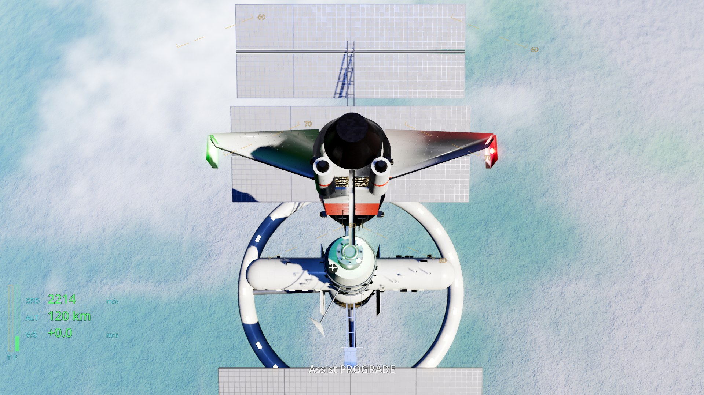

# The Filament Falcon

A home-built, three-seat spaceship cockpit simulator for a dad and two kids. The two kids fly as **Pilot** (left) and **Ops** (right), and Dad runs **Mission Control** from the seat behind them. The seats recline back, then a pod with the window monitors and instrument panels lowers into place in front of the crew. Every panel is 3D printed with backlit white lettering lit by a single WS2812B strip.

## What's here

| Folder | What it is |
|---|---|
| [`docs/SPEC.md`](docs/SPEC.md) | Master spec: roles, controls, displays, motion, and the contracts between folders |
| [`cad/`](cad/) | OpenSCAD sources, 3MF exports (multi-material and single-material + letter inserts), PNG renders |
| [`frame/`](frame/) | Wooden frame drawings, cut list, BOM, recline + pod motion geometry, safety rules |
| [`docs/mechanical/`](docs/mechanical/) | Print settings, switch BOM, display mounting and cabling, projector-dome study |
| [`firmware/`](firmware/) | ESP32-S3 USB HID joystick firmware (Falcon Pilot / Ops / Command) + WS2812B driver |
| [`docs/electronics/`](docs/electronics/) | Wiring diagrams (start with `01_simple_joystick.png`), parts list, Linux setup |
| [`game/`](game/) | Godot 4 game: three displays, six missions, Newtonian flight model |
| [`docs/game/`](docs/game/) | How to run it, display setup, kids' crew guide, screenshots |
| [`bom/`](bom/) | Editable bill of materials (`Filament_Falcon_BOM.xlsx`) with Amazon.ca links |
| [`shared/`](shared/) | Panel labels, input map, LED segment map, LED serial protocol |

## Hardware
Linux Mint PC with a Ryzen 9 5900X, an RX 6800 XT and 32 GB of RAM. Displays: a Sceptre C275B-144R and a Sceptre C275W-1920RN (27" curved, 1080p) as the forward windows, plus a ViewSonic TD2220 22" touchscreen as the center console.

## Safety
The seat recline and pod motion are hardwired (key, E-stop, fuse, two-hand hold-to-run, limit-switch interlocks) and are never driven by software. 3D-printed parts never carry harness load. Read `frame/README.md` before building.

## Status
v0.1 design and software. Nothing has been physically printed, wired or flashed yet.
