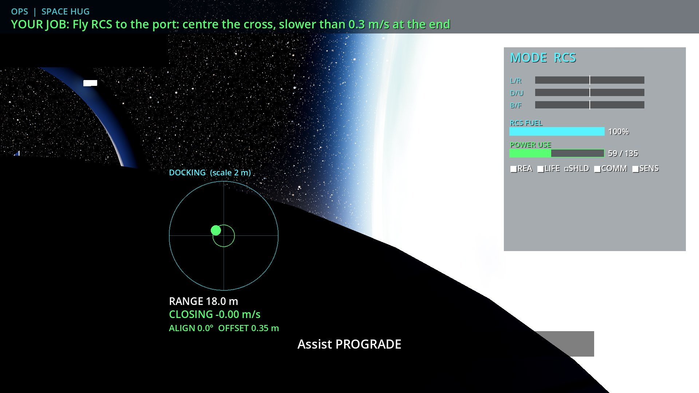

# The Filament Falcon: game (v0.1)

A two-seat (Pilot + Ops) spaceship cockpit game for Godot 4. Everything (planet, Moon, stars, ship,
station, sounds) is generated procedurally at start-up, so the repo stays small and has no
downloaded assets (see [CREDITS.md](CREDITS.md)).



More in [screenshots/](screenshots/): launch pad, ascent, station, docking, Moon, asteroid field, reentry plasma, runway,
the celebration screen, the kids' console pages (`18_`–`22_`), the Commander screen (`23_`–`27_`) and the
three-screen fallback with the Commander as a console tab (`28_`). They are rendered by `tests/run_screenshots.sh`
with the software Vulkan driver at the Ultra preset (`QUALITY=ultra`), so they look softer than on the real GPU.

### Graphics notes

- **Window views stay clean.** Only a small, semi-transparent HUD is drawn on the windows: speed/altitude/vertical
  speed bottom-left, throttle and fuel bars, flight-path markers, a faint horizon line with a gap in the middle,
  and short cues (countdown, sink rate, AoA, g, hull). The full instruments (attitude ball, speed and altitude
  tapes, orbit, Ap/Pe, assist, gear, flaps, engine) are on the kids' console, and a telemetry summary is on the
  Commander screen.
- **Exposure** is scripted, not automatic, so bots and screenshots are repeatable: the bright daytime sky
  stops down (about 0.78), space sits at about 0.92, and night inside the atmosphere opens up. ACES tonemapping.
- **Everything is procedural**, including the "textures": planet (continents, oceans with sun glint and
  Fresnel, cloud deck with cloud shadows and clear weather over the pad and runway, atmosphere scattering
  and limb), terrain (farm plots, roads, forest, rock; craters on the Moon), and the PBR panel shader used on
  the ship and station (panel lines, rivets, roughness variation, grime, MLI foil). Normal maps are
  "derivative bumps" computed in the shader from the same height functions.
- **Station** flies a fixed attitude to the local vertical with its docking port facing straight up, so the
  Falcon docks from above with Earth in the background. Its solar arrays turn to follow the sun.
- **Launch pad**: lattice service tower with crew and umbilical arms, flame trench, lightning masts, water
  tower, propellant spheres, floodlights, and a smoke/steam cloud while the engines fire near the pad.
  Engine plumes add a screen-space heat shimmer.

## 1. Install Godot (Linux Mint)

1. Download **Godot 4.7.x stable, standard (not .NET), Linux x86_64** from <https://godotengine.org/download/linux/>.
2. Unzip it somewhere *outside* the repo, e.g. `~/Apps/godot/`, and make it executable:
   ```bash
   chmod +x ~/Apps/godot/Godot_v4.7.2-stable_linux.x86_64
   sudo ln -s ~/Apps/godot/Godot_v4.7.2-stable_linux.x86_64 /usr/local/bin/godot
   ```
3. GPU driver: the RX 6800 XT uses Mesa RADV out of the box on Mint. Check with
   `vulkaninfo --summary` (package `vulkan-tools`) that the AMD GPU appears.
4. Optional extras:
   - `sudo apt install espeak-ng` gives spoken callouts. Without it you get text banners plus tones.
     A [piper](https://github.com/rhasspy/piper) voice also works: set `audio/piper_model` in the settings file.
   - `sudo apt install python3-serial` is needed for the LED panel bridge.

## 2. Run it

**Easiest:** `./run.sh --cockpit` (or `./run.sh --dev`) from the `game/` folder. On a fresh clone it imports the project first, which fixes the "Identifier CelestialBody not declared" parse errors you otherwise get on the very first launch. If you use `godot` directly, run `godot --headless --path . --import` once first.

`run.sh` also maps the touchscreen to the kids' console monitor before each launch (see
[Touch mapping](#touch-mapping-the-td2220)). Extra `run.sh` options: `--landscape-console` (turn the console
monitor to landscape first) and `--no-display-setup` (skip the touch mapping).

```bash
cd game
godot --path .                 # auto: cockpit mode if >= 3 screens, else dev mode
godot --path . -- --dev        # all four views tiled in one window (laptop / development)
godot --path . -- --cockpit    # force one fullscreen window per screen
godot --path . -- --quality=ultra --mission=docking
```

The first start imports the project, which takes a few seconds. Opening `game/project.godot` in the
editor and pressing F5 also works.

Keys:
- **Shift+Esc** quits.
- **Shift+End** toggles the dev/cockpit layout.
- **Esc** shows/hides the Commander tab on the console (only on a three-screen rig, see below).

Every cockpit control also has a keyboard key (see below and the CONTROLS page).

Useful command-line options (after `--`):

| Option | Effect |
|---|---|
| `--dev` / `--cockpit` | Force the window layout. |
| `--quality=low\|medium\|high\|ultra` | Graphics preset. Also on the Commander SETUP page. |
| `--mission=<id>` | Start mission: launch, docking, lunar, asteroids, reentry or sandbox. |
| `--no-voice` / `--no-led` | Turn off speech / the LED bridge. |
| `--shared-dir=/path/to/shared` | Use a different `shared/` folder (input_map.json, led_protocol.md). |

Settings are stored in `~/.local/share/filament-falcon/falcon_settings.cfg`. The Commander SETUP page shows the
exact path. Delete the file to get the defaults back.

## 3. The four screens

| Role | What it shows | Hardware on Yves's rig | xrandr output |
|---|---|---|---|
| **LEFT WINDOW** | out-the-window view + minimal HUD | Sceptre C275B-144R, 27" curved, 1920x1080 @ up to 144 Hz | DisplayPort-2 |
| **RIGHT WINDOW** | out-the-window view + minimal HUD | Sceptre C275W-1920RN, 27" curved, 1920x1080 @ 75 Hz | DisplayPort-1 |
| **KIDS' CONSOLE** | the crew's instruments and controls (touch) | ViewSonic TD2220, 22" optical touch, 1920x1080 @ 60 Hz | DisplayPort-0 |
| **COMMANDER** | mission control for the grown-up (mouse + keyboard) | 31.5" 1920x1080 monitor | HDMI-A-0 |

All views render at native 1920x1080 (the console also works in portrait, 1080x1920).

### What is on which screen

**Kids' console** (touch, big buttons; only things the crew acts on or watches):
- **FLIGHT** (the main page). Pilot half: attitude ball (ADI) with pitch ladder, roll scale and heading, speed
  and altitude tapes, climb rate, g, throttle and fuel bars, ENGINE ARM, IGNITION, GEAR, AIRBRAKE, FLAPS
  UP/HALF/DOWN, ASSIST OFF/STAB/PROGRADE/HOLD. Ops half: mode RCS/ARM/SCANNER, a live camera that follows the
  mode (docking camera in RCS, arm camera in ARM), target readout with NAV TARGET, SCANNER PING, TRIGGER,
  CARGO DOORS, DOCK CLAMP and the five power switches.
- **NAV**: orbit map, "highest/lowest point", STEER TO buttons for the Pilot, NAV TARGET for Ops.
- **SYSTEMS**: power distribution (all switches, power use, reactor), ship health bars, the fault list with
  what to do, SEAL LEAK, FIRE SUPPRESS, JUMP ARM/ENGAGE.
- **CAMERAS**: docking, arm and chase cameras.
- **CHECKLIST**: the overhead start-up switches in order, with DONE / NEXT / OUT OF ORDER.
- A task strip at the top always shows each kid's current job (blue = Pilot, orange = Ops) and flashes
  MASTER CAUTION. Every touch control mirrors a hardware control. When a board is plugged in, its switches
  win and the touch buttons only show their state.

**Commander screen** (mouse and keyboard; nothing here needs touch):
- **MISSION CONTROL**: mission select, START / PAUSE / RESUME / FLY AGAIN, RESTART, SKIP STEP, harness check,
  END FREE FLIGHT, failure injection, live score; orbit map with zoom, telemetry, time WARP and VIEW (cockpit or
  chase); crew status with both kids' current tasks and step, ship health, faults, MASTER CAUTION RESET.
- **BRIEFING**: the full briefing, both jobs, all objectives, the Commander tip, READ BRIEFING ALOUD.
- **TRAINING**: difficulty (EASY: +30 % fuel and RCS, half damage; HARD: −15 % fuel, 1.5× damage), skip the
  overhead checklist for little crews, checklist ALL ON / ALL OFF, assist override, voice callouts, failures.
- **CONTROLS**: live test of every switch, axis and button, devices, LED test, input-map template export.
- **SETUP**: screen roles, layout mode, quality, FPS cap, vsync, fullscreen, LED link, window geometry, QUIT.

### Which screen gets which role

At start-up the game reads `xrandr --listmonitors` (output names and physical sizes) and assigns roles in
this order:

1. `display/<role>_output` in the settings file, an output name such as `DisplayPort-0`, if that output exists.
2. `display/<role>_screen`, a Godot screen number, if it is 0 or more.
3. Automatic:
   - the console is the screen closest to 22", else a portrait screen, else the lowest one;
   - the Commander is the biggest remaining screen, but only if there is still one left for each window;
   - the windows are the remaining screens, left to right.

The defaults are `console_output="DisplayPort-0"`, with everything else automatic. On Yves's rig that gives
LEFT = DisplayPort-2, RIGHT = DisplayPort-1, CONSOLE = DisplayPort-0 and COMMANDER = HDMI-A-0.
The start-up log prints the result (`display: cockpit layout on 4 screens …`).

To change it, open **Commander → SETUP → SCREENS**:
- **◀ ▶** cycles each role through AUTO, screen 0, 1, 2, … (stored by output name).
- **IDENTIFY / IDENTIFY ALL** flashes the role name on its monitor.
- **APPLY WINDOW LAYOUT** moves the windows.

You can also edit the settings file while the game is closed:

```ini
[display]
mode="auto"                 ; auto | cockpit | dev
left_output="DisplayPort-2"
right_output="DisplayPort-1"
console_output="DisplayPort-0"
commander_output="HDMI-A-0"
```

**Three screens only** (no Commander monitor): the game still runs in cockpit mode. The Commander UI becomes
a **⚙ COMMANDER** tab on the kids' console, and **Esc** jumps to it and back. **Dev mode** (`--dev`, or fewer
than 3 screens) tiles all four views in one window: the windows on top, the console and Commander underneath.

**Console rotation:** the game detects a portrait console (1080x1920) and lays the console out top-to-bottom
(Pilot above Ops). **Landscape is recommended**: it is what the UI is designed for, and the TD2220's touch
mapping is simplest when it is not rotated. To turn it to landscape, use `./run.sh --landscape-console`,
`tools/setup_displays.sh --landscape`, or Cinnamon's *Display* settings (rotation "Normal").

### Forward window geometry

The two forward windows share one eye point and use **off-axis (asymmetric) frusta** built from the real
monitor geometry, so together they act as one continuous windscreen and the bezel gap behaves like a
window post. Measure your rig and enter the numbers on **Commander → SETUP** (or in the settings file):

| Setting | Default | Meaning |
|---|---|---|
| `monitor_width_m` / `monitor_height_m` | 0.597 / 0.336 | Visible panel size of a 27" 16:9 monitor. |
| `monitor_gap_m` | 0.06 | Gap between the two panels' picture edges. |
| `eye_distance_m` | 0.62 | Eyes to monitor plane. |
| `eye_height_m` | 0.0 | Eyes above (+) or below (−) the monitor centre. |
| `toe_in_deg` | 0 | Angle each monitor is turned toward the centre. |
| `view_scale` | 1.15 | >1 widens the field of view a bit (more dramatic, less "true"). |

The panels are slightly curved, but the frustum assumes flat panels. At 27" the error is small. If straight
lines bend at the inner edges, add a few degrees of toe-in.

### Screen placement (X11 / Cinnamon)

```bash
xrandr --listmonitors              # output names, sizes in mm and positions
# Example: Commander monitor left, the two windows side by side, console (landscape) under the windows
xrandr --output HDMI-A-0 --mode 1920x1080 --pos 0x0 \
       --output DisplayPort-2 --mode 1920x1080 --rate 75 --pos 1920x0 \
       --output DisplayPort-1 --mode 1920x1080 --rate 75 --pos 3840x0 \
       --output DisplayPort-0 --mode 1920x1080 --rotate normal --primary --pos 2880x1080
```

The positions only matter to the desktop: the game puts each role on its output by name. Save the arrangement
in Cinnamon's *Display* settings so it survives a reboot.

### Refresh rates (144 Hz + 75 Hz + 60 Hz + 60 Hz)

One render loop feeds all four windows. If every window waited for its own vsync (FIFO), the loop
would block on whichever screen is slowest and frame pacing would jitter. The defaults are:

- **Frame cap 75 FPS** (`display/max_fps`). The RX 6800 XT holds this easily at ultra on two 3D views plus
  two UI screens. The console and Commander render only 2D, apart from small camera feeds.
- **MAILBOX vsync on every window** (`display/vsync = mailbox`). There is no tearing, and presenting never blocks on another screen.
- **Recommendation:** run the 144 Hz Sceptre at **75 Hz** (the `xrandr --rate 75` above), so both forward
  windows refresh at the same rate as the frame cap. This gives perfectly even motion across the windscreen
  seam. If you prefer 144 Hz on that panel, set the cap to 144 on SETUP. The 75 Hz panel will then drop
  frames evenly, and the 6800 XT has the headroom.
- The touchscreen and the Commander monitor run at 60 Hz. They only show UI, so the cap does not matter there.

Both settings can be changed live on **Commander → SETUP** (60/75/120/144 FPS; VSYNC MAILBOX/FIFO/OFF).

### Touch mapping (the TD2220)

The console UI is laid out for 22" 1080p (about 100 px per inch). Buttons are 76–100 px (19–25 mm) tall,
and text is 22–34 px, readable from the seats. The optical touch panel is a USB HID touch device. By default X
spreads its touches over the whole desktop, which is why taps landed on the wrong monitor. X must map it to the
console output only.

`game/tools/setup_displays.sh` does this, and **`run.sh` calls it before every launch**. It:
- finds the touch device in `xinput list`: names containing *NextWindow*, *ViewSonic* or *touch*, but not touchpads;
- takes the console output from the game's settings (`console_output`), else from the last run's
  `~/.local/share/filament-falcon/displays.env`, else `DisplayPort-0`;
- runs `xinput map-to-output <device> <output>`;
- does nothing, quietly, if there is no X display, no `xinput` (`sudo apt install xinput`), no touch device, or
  the output is not connected.

```bash
game/tools/setup_displays.sh --list            # show outputs + touch devices, change nothing
game/tools/setup_displays.sh                   # map touch -> console output
game/tools/setup_displays.sh --landscape       # also rotate the console output to landscape first
game/tools/setup_displays.sh --output DisplayPort-0 --device "NextWindow"   # override detection
```

**Make it permanent** (the mapping is lost at logout, reboot or when the USB cable is replugged):

- *Cinnamon:* **Menu → Startup Applications → + → Custom command**.
  - Name: `Falcon touch mapping`
  - Command: `/home/yves/filament-falcon/game/tools/setup_displays.sh` (add `--landscape` if wanted)
  - Startup delay: `5` seconds
- *Or* create `~/.config/autostart/falcon-touch.desktop`:

  ```ini
  [Desktop Entry]
  Type=Application
  Name=Falcon touch mapping
  Exec=/home/yves/filament-falcon/game/tools/setup_displays.sh --quiet
  X-GNOME-Autostart-Delay=5
  ```

  Adjust the path to wherever the repo is cloned.

If the touch cable gets replugged during a session, run the script again (or just restart via `run.sh`). Use
the default X11 Cinnamon session; on Wayland the compositor's own touch-mapping setting is needed instead.

### Later: projector dome (3× HY300)

The out-the-window rendering is generic, so this is planned for but not built yet:
- `display/views` lists the outputs (default `left,right`). Each output gets its own SubViewport, camera, HUD and OS window.
- `DisplayManager.screen_rect_for(name)` describes each output as a physical rectangle in eye space, and
  `off_axis()` turns any rectangle into an asymmetric frustum. Three projectors would just add three
  rectangles (one per projector's slice of the dome).
- `display/<name>_warp` can point at a `canvas_item` shader that is applied to that output's final image.
  A dome would use it to pre-distort each projector image (mesh/UV warp and edge blending). It is empty by default.

## 4. Controls, joysticks and the shared contract

- Mapping comes from `../shared/input_map.json`, the contract with the firmware.
  If that file is missing or broken, built-in defaults are used. The CONTROLS page shows which source is active.
- Boards are matched by name substring ("Falcon Pilot", "Falcon Ops", "Falcon Command"). On Linux the
  name is like "Filament Falcon Falcon Pilot". They can also be matched by USB VID `0x1209` and PID
  `0x0003` (Pilot), `0x0004` (Ops) or `0x0005` (Command).
- Rotary encoders (assist mode, ops mode, mission select) send next/prev/push presses. The game keeps
  track of the selected position. The dimmer is an axis, FLAPS is a 3-position toggle, and NAV TGT is a single push.
- When a board is connected, its switches win. The touchscreen switch buttons are disabled for those
  controls, so the physical switch is always the truth.
- **CONTROLS page** (Commander screen): live state of every action, the device list, an "export template" button and an LED test.

Keyboard fallback (every action has one):

| Pilot | Key | Ops | Key | Commander / overhead | Key |
|---|---|---|---|---|---|
| Pitch | W/S | RCS left/right | J/L | Master power | F12 |
| Roll | Q/E | RCS down/up | K/I | Battery … Ign arm | F1–F6 |
| Yaw | A/D | RCS back/fwd | N/H | Cabin lights / beacon / strobe | F7 / F8 / F10 |
| Throttle | Shift/Ctrl | Trigger | Enter | Start / pause | F9 / Pause |
| Trigger (laser) | F | Reactor / life / shields / comms / sensors | 5–9 | Mission ◀ ▶ / select | PgUp / PgDn / Insert |
| Engine arm / ignition | T / Space | Fire suppression | R | Caution reset | Backspace |
| Boost / airbrake | Tab / B | Scanner ping | P | Fail: fire / leak / power / sensor | Ctrl+1…4 |
| Flaps up / down | , / . | Cargo doors / dock clamp | O / U | Seats up | Home |
| Gear / view | G / V | Nav target | M | Eject (covered) | F11 |
| Assist OFF/STAB/PRO/HOLD | 1–4 | Mode RCS / ARM / SCANNER | Z / X / C | Intercom | ` |
| Assist knob ◀ ▶ | − / = | Jump arm / engage | [ / ] | | |

## 5. LED panel (serial) and udev

Godot has no serial API, so the game starts the bundled helper `game/tools/falcon_led_bridge.py`
automatically. The game sends protocol lines over UDP to `127.0.0.1:47800`, and the helper writes them to the
Command board. If python3 or pyserial is missing, or no board is plugged in, the game carries on without LEDs.
The Commander SETUP page shows the bridge status.

- Port lookup:
  1. `/dev/falcon-command` (udev rule from the firmware branch, `firmware/udev/`)
  2. `/dev/serial/by-id/*Falcon_Command*`
  3. any port with VID:PID `1209:0005`
- Install the udev rule from the firmware folder (`sudo cp …rules /etc/udev/rules.d/ && sudo udevadm control --reload && sudo udevadm trigger`).
  Also add yourself to `dialout` (`sudo usermod -aG dialout $USER`, then log out and in) so no sudo is needed.
- Opening the port asserts DTR, which the board takes to mean "game connected". Closing it returns the strip to its idle glow.
  The board stays silent unless `ACK ON` is sent. The bridge logs any `ERR`/`EVT` lines to stderr.
- Test without the game: `python3 game/tools/falcon_led_bridge.py --dry-run`.

## 6. Crew guide (for kids!)

**Three jobs:**
- **PILOT** (left seat) flies the Falcon with the big stick and throttle. You point the ship, fire the
  engine, land it, and fire the mining laser.
- **OPS** (right seat) runs the ship. You handle power, shields, the RCS stick that slides the ship sideways,
  the robot arm and tractor beam, the scanner, the jump drive, and fixing things when they break.
- **COMMANDER** (a grown-up, or whoever is not flying) sits at the Commander screen: picks the mission,
  checks the harnesses, presses START, watches both kids' tasks on MISSION CONTROL, and can make things go
  wrong on purpose (engine fire, cabin leak, power fault, sensor glitch) to see if the crew can fix it.

**Before every mission:**
1. Turn the MASTER POWER key.
2. Flip the overhead switches **in order, left to right**: BATTERY, FUEL PUMPS, AVIONICS, APU, GUIDANCE,
   IGNITION ARM. Each one lights green when it is done in the right order (CHECKLIST page).
3. Both crew sit down and say "harness on!". The commander checks, clicks HARNESSES on MISSION CONTROL, then presses START.

**Flight assist (the knob):**
- **STAB** stops the ship from spinning.
- **PROGRADE** points the nose along the NAV vector.
- **HOLD** locks the nose where it is.
- **OFF** is real space: nothing slows you down!

The physics is real. The assists make it easy.

**Missions:**

| # | Mission | What happens | Pilot hero moment | Ops hero moment |
|---|---|---|---|---|
| 1 | **First Light** (launch) | Countdown, lift-off, fly to orbit and drop off a satellite. | Lighting the engine at T−5 and steering into orbit. | Staging the booster and releasing the satellite with the arm. |
| 2 | **Space Hug** (docking) | Glide into the space station slower than a snail. | Keeping the nose dead-on with HOLD. | Creeping in with the RCS stick on the docking camera, then DOCK CLAMP! |
| 3 | **Eagle Eye** (lunar) | Skim the Moon, find the beacon and land like a feather. | Slowing down and hovering to a soft touchdown. | Finding the beacon with the scanner and sliding the ship over it. |
| 4 | **Rock Hoppers** (asteroids) | Rescue a lost pod, mine three crystals, jump home. | Dodging rocks and lasering crystal rocks. | Tractor-beaming the pod and crystals aboard, then the JUMP! |
| 5 | **Homecoming** (reentry) | Blaze through the fiery air and glide onto the runway. | Holding the nose up, then flying the green boxes down to the runway. | Shields, beating the radio blackout, finding the runway. |
| 6 | **Free Flight** (sandbox) | No rules: visit every place with the jump drive. | Try ASSIST OFF! | Play with the arm, scanner and jump drive. |

Each mission shows a briefing with a job for each seat. The strip at the top of the kids' console always
shows each seat's current job, and the Commander's BRIEFING page lists every step with a ▶. At the end you
get a score, up to three stars and a celebration.

Tips:
- Go slow near things. The scoring loves gentle contact.
- If the MASTER CAUTION flashes, Ops looks at SYSTEMS. The fault list says what to do.
- The console's NAV page shows your orbit. On the Commander's MISSION CONTROL, **WARP** speeds time up while coasting. It drops back to ×1 when an engine fires or you get low.
  In the air it is limited to ×4.
- Homecoming is the longest mission: about 11 minutes, or about 4½ minutes using WARP ×4 during the high glide.

## 7. Tests (for developers)

```bash
cd game
godot --headless --path . --import                                        # import; must show no errors
godot --headless --path . --audio-driver Dummy -- --smoke-test           # every mission start→finish + every failure fixed by crew actions,
                                                                          # + screen-role resolver (4- and 3-screen rigs) and every console/Commander page
godot --headless --path . --audio-driver Dummy -- --flight-test          # bots actually FLY every mission with cockpit controls
godot --headless --path . --audio-driver Dummy -- --flight-test --only=reentry --trace
GODOT=godot tests/run_screenshots.sh                                      # screenshots via xvfb + lavapipe → docs/game/screenshots/
```

The smoke and flight tests exit with a non-zero code on failure. The flight test bots use only the same
inputs the crew have (switches, sticks, throttle, buttons). Each mission is completed with real physics,
with no teleporting.

Debug flags: `--persp` uses a plain 70° camera instead of the off-axis frustum. `--far=`/`--near=` override the
clip planes. Keep far/near ≤ 1e6, because float32 frustum culling breaks beyond that. Distant bodies are drawn
in "scaled space" so their size on screen stays correct.
