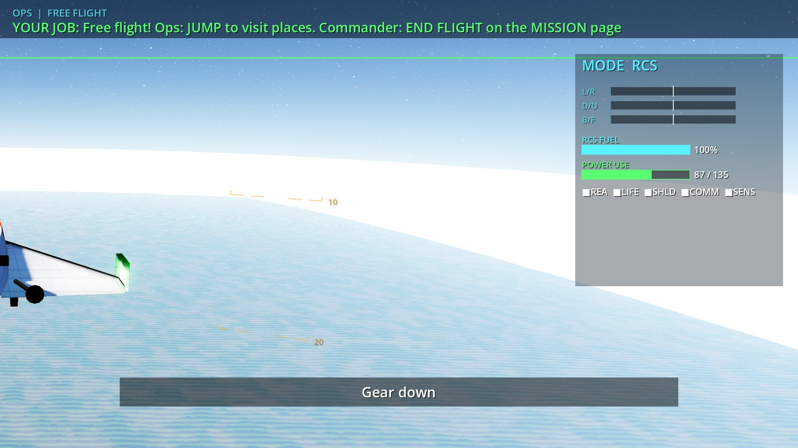

# The Filament Falcon: game (v0.1)

A two-seat (Pilot + Ops) spaceship cockpit game for Godot 4. Everything (planet, Moon, stars, ship,
station, sounds) is generated procedurally at start-up, so the repo stays small and has no
downloaded assets (see [CREDITS.md](CREDITS.md)).



More in [screenshots/](screenshots/): launch pad, ascent, station, docking, Moon, asteroid field, reentry plasma, runway,
the celebration screen and all seven touchscreen pages (`18_`–`24_`). They are rendered by `tests/run_screenshots.sh`
with the software Vulkan driver, so they look softer than on the real GPU.

## 1. Install Godot (Linux Mint)

1. Download **Godot 4.7.x stable, standard (not .NET), Linux x86_64** from <https://godotengine.org/download/linux/>.
2. Unzip it somewhere *outside* the repo, e.g. `~/Apps/godot/`, and make it executable:
   ```bash
   chmod +x ~/Apps/godot/Godot_v4.7.2-stable_linux.x86_64
   sudo ln -s ~/Apps/godot/Godot_v4.7.2-stable_linux.x86_64 /usr/local/bin/godot
   ```
3. GPU driver: the RX 6800 XT uses Mesa RADV out of the box on Mint. Check with
   `vulkaninfo --summary` (package `vulkan-tools`) that the AMD GPU appears.
4. Optional extras:
   - `sudo apt install espeak-ng` gives spoken callouts. Without it you get text banners plus tones.
     A [piper](https://github.com/rhasspy/piper) voice also works: set `audio/piper_model` in the settings file.
   - `sudo apt install python3-serial` is needed for the LED panel bridge.

## 2. Run it

```bash
cd game
godot --path .                 # auto: cockpit mode if >= 3 screens, else dev mode
godot --path . -- --dev        # all three views tiled in one window (laptop / development)
godot --path . -- --cockpit    # force one fullscreen window per screen
godot --path . -- --quality=ultra --mission=docking
```

The first start imports the project, which takes a few seconds. Opening `game/project.godot` in the
editor and pressing F5 also works.

Keys:
- **Shift+Esc** quits.
- **Shift+End** toggles the dev/cockpit layout.

Every cockpit control also has a keyboard key (see below and the CONTROLS page).

Useful command-line options (after `--`):

| Option | Effect |
|---|---|
| `--dev` / `--cockpit` | Force the window layout. |
| `--quality=low\|medium\|high\|ultra` | Graphics preset. Also on the SETUP page. |
| `--mission=<id>` | Start mission: launch, docking, lunar, asteroids, reentry or sandbox. |
| `--no-voice` / `--no-led` | Turn off speech / the LED bridge. |
| `--shared-dir=/path/to/shared` | Use a different `shared/` folder (input_map.json, led_protocol.md). |

Settings are stored in `~/.local/share/filament-falcon/falcon_settings.cfg`. The SETUP page shows the
exact path. Delete the file to get the defaults back.

## 3. The three displays

| Output | Hardware | Default |
|---|---|---|
| LEFT window | Sceptre C275B-144R, 27" curved, 1920x1080 @ 144 Hz | screen 1 |
| RIGHT window | Sceptre C275W-1920RN, 27" curved, 1920x1080 @ 75 Hz | screen 2 |
| CONSOLE | ViewSonic TD2220, 22" optical touch, 1920x1080 @ 60 Hz | screen 0 |

All three views render at native 1920x1080.

The two forward windows share one eye point and use **off-axis (asymmetric) frusta** built from the real
monitor geometry, so together they act as one continuous windscreen and the bezel gap behaves like a
window post. Measure your rig and enter the numbers on **SETUP → DISPLAYS** (or in the settings file):

| Setting | Default | Meaning |
|---|---|---|
| `monitor_width_m` / `monitor_height_m` | 0.597 / 0.336 | Visible panel size of a 27" 16:9 monitor. |
| `monitor_gap_m` | 0.06 | Gap between the two panels' picture edges. |
| `eye_distance_m` | 0.62 | Eyes to monitor plane. |
| `eye_height_m` | 0.0 | Eyes above (+) or below (−) the monitor centre. |
| `toe_in_deg` | 0 | Angle each monitor is turned toward the centre. |
| `view_scale` | 1.15 | >1 widens the field of view a bit (more dramatic, less "true"). |

The panels are slightly curved, but the frustum assumes flat panels. At 27" the error is small. If straight
lines bend at the inner edges, add a few degrees of toe-in.

### Screen numbers and placement (X11 / Cinnamon)

```bash
xrandr --listmonitors                     # see output names, e.g. DP-1, DP-2, HDMI-A-1
# Example layout: console centre-bottom is primary, windows side by side above it
xrandr --output HDMI-A-1 --primary --mode 1920x1080 --rate 60 --pos 960x1080 \
       --output DP-1 --mode 1920x1080 --rate 75 --pos 0x0 \
       --output DP-2 --mode 1920x1080 --rate 75 --pos 1920x0
```

Then use **SETUP → LEFT/RIGHT/CONSOLE screen − / +** and **IDENTIFY** to put each view on the right screen,
and press **APPLY WINDOW LAYOUT**. To keep the layout across reboots, save it in Cinnamon's *Display*
settings or put the `xrandr` line in *Startup Applications*.

### Refresh rates (144 Hz + 75 Hz + 60 Hz)

One render loop feeds all three windows. If every window waited for its own vsync (FIFO), the loop
would block on whichever screen is slowest and frame pacing would jitter. The defaults are:

- **Frame cap 75 FPS** (`display/max_fps`). The RX 6800 XT holds this easily at ultra on three 1080p outputs.
- **MAILBOX vsync on every window** (`display/vsync = mailbox`). There is no tearing, and presenting never blocks on another screen.
- **Recommendation:** run the 144 Hz Sceptre at **75 Hz** (the `xrandr --rate 75` above), so both forward
  windows refresh at the same rate as the frame cap. This gives perfectly even motion across the windscreen
  seam. If you prefer 144 Hz on that panel, set the cap to 144 on SETUP. The 75 Hz panel will then drop
  frames evenly, and the 6800 XT has the headroom.
- The touchscreen runs at 60 Hz. It only shows UI, so the cap does not matter there.

Both settings can be changed live on **SETUP → GRAPHICS** (60/75/120/144 FPS; VSYNC MAILBOX/FIFO/OFF).

### Touchscreen (ViewSonic TD2220)

The console UI is laid out for 22" 1080p (about 100 px per inch). Buttons are at least 64 px (16 mm) and
mostly 80–120 px, and body text is 22–32 px, readable from the seat. The optical touch panel appears as
a USB HID touch device. X must send its touches to the console screen only, otherwise taps land on the
spanning desktop:

```bash
xinput list                                # find the touch device name/id (contains "ViewSonic" or the touch controller's name)
xinput map-to-output "<touch device name>" HDMI-A-1    # the console's xrandr output
```

Add that line to *Startup Applications* (after the `xrandr` line) so it survives a reboot.
A Wayland session needs the compositor's own touch-mapping setting instead. Use the default X11
Cinnamon session.

### Later: projector dome (3× HY300)

The out-the-window rendering is generic, so this is planned for but not built yet:
- `display/views` lists the outputs (default `left,right`). Each output gets its own SubViewport, camera, HUD and OS window.
- `DisplayManager.screen_rect_for(name)` describes each output as a physical rectangle in eye space, and
  `off_axis()` turns any rectangle into an asymmetric frustum. Three projectors would just add three
  rectangles (one per projector's slice of the dome).
- `display/<name>_warp` can point at a `canvas_item` shader that is applied to that output's final image.
  A dome would use it to pre-distort each projector image (mesh/UV warp and edge blending). It is empty by default.

## 4. Controls, joysticks and the shared contract

- Mapping comes from `../shared/input_map.json`, the contract with the firmware.
  If that file is missing or broken, built-in defaults are used. The CONTROLS page shows which source is active.
- Boards are matched by name substring ("Falcon Pilot", "Falcon Ops", "Falcon Command"). On Linux the
  name is like "Filament Falcon Falcon Pilot". They can also be matched by USB VID `0x1209` and PID
  `0x0003` (Pilot), `0x0004` (Ops) or `0x0005` (Command).
- Rotary encoders (assist mode, ops mode, mission select) send next/prev/push presses. The game keeps
  track of the selected position. The dimmer is an axis, FLAPS is a 3-position toggle, and NAV TGT is a single push.
- When a board is connected, its switches win. The touchscreen switch buttons are disabled for those
  controls, so the physical switch is always the truth.
- **CONTROLS page:** live state of every action, the device list, an "export template" button and an LED test.

Keyboard fallback (every action has one):

| Pilot | Key | Ops | Key | Commander / overhead | Key |
|---|---|---|---|---|---|
| Pitch | W/S | RCS left/right | J/L | Master power | F12 |
| Roll | Q/E | RCS down/up | K/I | Battery … Ign arm | F1–F6 |
| Yaw | A/D | RCS back/fwd | N/H | Cabin lights / beacon / strobe | F7 / F8 / F10 |
| Throttle | Shift/Ctrl | Trigger | Enter | Start / pause | F9 / Pause |
| Trigger (laser) | F | Reactor / life / shields / comms / sensors | 5–9 | Mission ◀ ▶ / select | PgUp / PgDn / Insert |
| Engine arm / ignition | T / Space | Fire suppression | R | Caution reset | Backspace |
| Boost / airbrake | Tab / B | Scanner ping | P | Fail: fire / leak / power / sensor | Ctrl+1…4 |
| Flaps up / down | , / . | Cargo doors / dock clamp | O / U | Seats up | Home |
| Gear / view | G / V | Nav target | M | Eject (covered) | F11 |
| Assist OFF/STAB/PRO/HOLD | 1–4 | Mode RCS / ARM / SCANNER | Z / X / C | Intercom | ` |
| Assist knob ◀ ▶ | − / = | Jump arm / engage | [ / ] | | |

## 5. LED panel (serial) and udev

Godot has no serial API, so the game starts the bundled helper `game/tools/falcon_led_bridge.py`
automatically. The game sends protocol lines over UDP to `127.0.0.1:47800`, and the helper writes them to the
Command board. If python3 or pyserial is missing, or no board is plugged in, the game carries on without LEDs.
The SETUP page shows the bridge status.

- Port lookup:
  1. `/dev/falcon-command` (udev rule from the firmware branch, `firmware/udev/`)
  2. `/dev/serial/by-id/*Falcon_Command*`
  3. any port with VID:PID `1209:0005`
- Install the udev rule from the firmware folder (`sudo cp …rules /etc/udev/rules.d/ && sudo udevadm control --reload && sudo udevadm trigger`).
  Also add yourself to `dialout` (`sudo usermod -aG dialout $USER`, then log out and in) so no sudo is needed.
- Opening the port asserts DTR, which the board takes to mean "game connected". Closing it returns the strip to its idle glow.
  The board stays silent unless `ACK ON` is sent. The bridge logs any `ERR`/`EVT` lines to stderr.
- Test without the game: `python3 game/tools/falcon_led_bridge.py --dry-run`.

## 6. Crew guide (for kids!)

**Three jobs:**
- **PILOT** (left seat) flies the Falcon with the big stick and throttle. You point the ship, fire the
  engine, land it, and fire the mining laser.
- **OPS** (right seat) runs the ship. You handle power, shields, the RCS stick that slides the ship sideways,
  the robot arm and tractor beam, the scanner, the jump drive, and fixing things when they break.
- **COMMANDER** (a grown-up, or whoever is not flying) picks the mission, flips the overhead checklist,
  presses START, and can make things go wrong on purpose (engine fire, cabin leak, power fault,
  sensor glitch) to see if the crew can fix it.

**Before every mission:**
1. Turn the MASTER POWER key.
2. Flip the overhead switches **in order, left to right**: BATTERY, FUEL PUMPS, AVIONICS, APU, GUIDANCE,
   IGNITION ARM. Each one lights green when it is done in the right order (CHECKLIST page).
3. Both crew sit down and say "harness on!", then the commander presses START.

**Flight assist (the knob):**
- **STAB** stops the ship from spinning.
- **PROGRADE** points the nose along the NAV vector.
- **HOLD** locks the nose where it is.
- **OFF** is real space: nothing slows you down!

The physics is real. The assists make it easy.

**Missions:**

| # | Mission | What happens | Pilot hero moment | Ops hero moment |
|---|---|---|---|---|
| 1 | **First Light** (launch) | Countdown, lift-off, fly to orbit and drop off a satellite. | Lighting the engine at T−5 and steering into orbit. | Staging the booster and releasing the satellite with the arm. |
| 2 | **Space Hug** (docking) | Glide into the space station slower than a snail. | Keeping the nose dead-on with HOLD. | Creeping in with the RCS stick on the docking camera, then DOCK CLAMP! |
| 3 | **Eagle Eye** (lunar) | Skim the Moon, find the beacon and land like a feather. | Slowing down and hovering to a soft touchdown. | Finding the beacon with the scanner and sliding the ship over it. |
| 4 | **Rock Hoppers** (asteroids) | Rescue a lost pod, mine three crystals, jump home. | Dodging rocks and lasering crystal rocks. | Tractor-beaming the pod and crystals aboard, then the JUMP! |
| 5 | **Homecoming** (reentry) | Blaze through the fiery air and glide onto the runway. | Holding the nose up, then flying the green boxes down to the runway. | Shields, beating the radio blackout, finding the runway. |
| 6 | **Free Flight** (sandbox) | No rules: visit every place with the jump drive. | Try ASSIST OFF! | Play with the arm, scanner and jump drive. |

Each mission shows a briefing with a job for each seat. The MISSION page always shows the current step
with a ▶. At the end you get a score, up to three stars and a celebration.

Tips:
- Go slow near things. The scoring loves gentle contact.
- If the MASTER CAUTION flashes, Ops looks at SYSTEMS. The fault list says what to do.
- NAV page: the map shows your orbit, and **WARP** speeds time up while coasting. It drops back to ×1 when an engine fires or you get low.
  In the air it is limited to ×4.
- Homecoming is the longest mission: about 11 minutes, or about 4½ minutes using WARP ×4 during the high glide.

## 7. Tests (for developers)

```bash
cd game
godot --headless --path . --import                                        # import; must show no errors
godot --headless --path . --audio-driver Dummy -- --smoke-test           # every mission start→finish + every failure fixed by crew actions
godot --headless --path . --audio-driver Dummy -- --flight-test          # bots actually FLY every mission with cockpit controls
godot --headless --path . --audio-driver Dummy -- --flight-test --only=reentry --trace
GODOT=godot tests/run_screenshots.sh                                      # screenshots via xvfb + lavapipe → docs/game/screenshots/
```

The smoke and flight tests exit with a non-zero code on failure. The flight test bots use only the same
inputs the crew have (switches, sticks, throttle, buttons). Each mission is completed with real physics,
with no teleporting.

Debug flags: `--persp` uses a plain 70° camera instead of the off-axis frustum. `--far=`/`--near=` override the
clip planes. Keep far/near ≤ 1e6, because float32 frustum culling breaks beyond that. Distant bodies are drawn
in "scaled space" so their size on screen stays correct.
