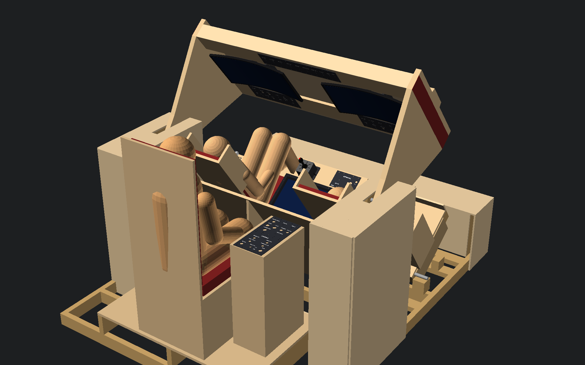
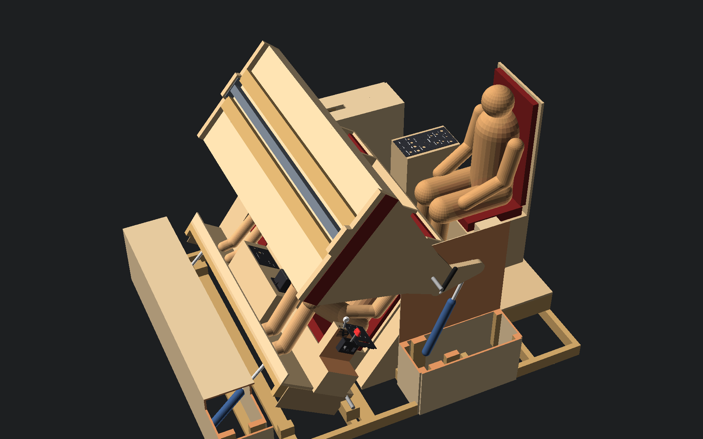
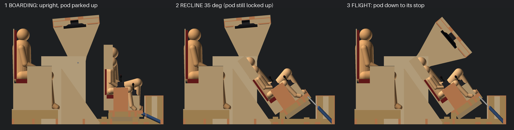
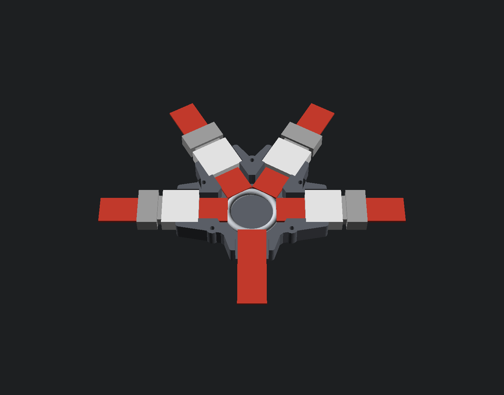

# The Filament Falcon - mechanical (printed parts + panels)

Everything a person touches is printed and bolts to the wooden frame (`frame/`).
OpenSCAD sources live in `cad/`, ready-to-slice 3MF files in `cad/export/3mf/`,
renders in `cad/export/png/`. Units: mm (inches in brackets where useful).



Motion (v0.3): the kid seats **recline** 35 deg, then the instrument **pod** (both
monitors, dash and overhead panels) swings down in front of them. Reverse to get
out. The pod is driven by a **single** 1500 N self-locking actuator in the left
casing; a 2" square steel torque tube behind the pod's back sheet ties the right
cheek to it, and two gas struts keep the pod slightly lift-biased so an actuator
failure sends it up, away from the kids. Details, safety concept and interlock:
[`frame/README.md`](../../frame/README.md).





More: `cad/export/png/overview_*.png` (boarding/flight from front and rear, dad's
view, side sections, `overview_pod_drive` = left casing opened: actuator, strut, torque tube). Displays and cabling: [`displays.md`](displays.md).
Projector dome feasibility: [`projector_dome_study.md`](projector_dome_study.md).

## Folder map

| Path | What |
|---|---|
| `cad/lib/ff_lib.scad` | the parametric library: 40 mm grid, M5 holes, standard cut-outs, light boxes, seams, missile-switch guard |
| `cad/lib/ff_panel.scad` | panel builder (body, letters, inserts, previews) |
| `cad/tools/layouts.py` | **single source of truth** for every lettered panel (controls, labels, LED strip order) |
| `cad/tools/gen_panels.py` | layouts -> `cad/panels/*.scad` + `shared/panel_labels.json` + layout checks |
| `cad/tools/build.py` | exports every 3MF, validates it, renders every PNG + the assembled overview |
| `cad/tools/switch_bom.py` | writes `docs/mechanical/switch_bom.md` (bill of switches per panel) |
| `cad/parts/*.scad` | non-panel parts (throttle, gear lever, joystick housing, TD2220 trim + riser, monitor standoffs, harness hub, pivot cable clamps, enclosures, clips, guards) |
| `cad/assembly/overview.scad` | whole cockpit (frame from `frame/generated/frame.scad` + all parts); `STATE` = boarding / reclined / flight / custom (`TH`, `AL`) |
| `cad/assembly/dome_concept.scad` | concept only: HY300 rear-projection dome (see the dome study) |
| `cad/fonts/` | Barlow Condensed Black (SIL OFL) used for all lettering |
| `cad/export/validation_report.json` | per-file checks (watertight, volume, footprint, triangle counts, lib3mf read-back) |

Rebuild everything (OpenSCAD 2025+ with the Manifold backend recommended):

```
python cad/tools/gen_panels.py            # after editing layouts.py
python cad/tools/switch_bom.py
python frame/frame_model.py               # frame -> frame/generated/frame.scad
python cad/tools/build.py --openscad /path/to/openscad   # 3MF + PNG + checks
```

Python needs: trimesh, numpy, networkx, manifold3d, lib3mf, fonttools, shapely, matplotlib.

## Panels

All panels are 3 mm thick, dark body, white letters that go through the full
thickness. Panels are multiples of the 40 mm grid and printed 0.5 mm smaller
than nominal so neighbours never bind. The top and bottom 20 mm bands carry the
M5 holes (10 mm from the edge, every 40 mm) and sit flat on the plywood rails;
all light boxes, ribs and switch bodies are inside the 120 mm (or 80 / 160 mm)
bay opening.

| Panel | Size | Labels | Where |
|---|---|---|---|
| `PILOT_DASH_A` | 200 x 160 | 7 | Pilot dash (pod lower band), outboard half (left seat) |
| `PILOT_DASH_B` | 200 x 160 | 8 | Pilot dash, inboard half (joins A with 2 alignment pins) |
| `PILOT_SIDE` | 200 x 160 | 6 | Pilot outboard side console: THROTTLE + LANDING GEAR slots |
| `OPS_DASH_A` | 200 x 160 | 6 | Ops dash, inboard half: power toggles |
| `OPS_DASH_B` | 200 x 160 | 8 | Ops dash, outboard half: mode rotary + payload |
| `OPS_SIDE` | 200 x 160 | 4 | Ops inboard side console: JUMP ARM (guarded) + ENGAGE (collar) |
| `OVERHEAD_A/B/C` | 3 x 200 x 120 | 3/3/4 | pod upper band (above the monitors), launch checklist row + lights + EJECT |
| `CMD_A` | 200 x 200 | 8 | commander: master power key, mission, start/pause, caution reset, PA, dimmer |
| `CMD_B` | 200 x 200 | 10 | commander: failure injection + crew **MOTION** (key, FLT/BRD hold-to-run, E-stop) |

67 backlit labels in total; every one is listed (id, panel, text, position, strip
order) in `shared/panel_labels.json`. The bill of switches/buttons/LEDs per panel
is in [`switch_bom.md`](switch_bom.md).

Files per panel (in `cad/export/3mf/panels/`):

- `<ID>_multimaterial.3mf` - body (extruder 1, black) + letters (extruder 2, white) as two parts of one object. Opens with the colours/extruders already assigned in PrusaSlicer, OrcaSlicer and Bambu Studio. In other slicers: import, then assign the "letters" part to the white filament.
- `<ID>_single_body.3mf` - single-material fallback: the body with through-pockets where the letters go. Letters with closed counters (A, B, D, O, P, R, 0, 4, 6, 8, 9) use small 1.2 mm stencil bridges so the islands stay attached.
- `<ID>_single_letter_inserts_WHITE.3mf` - the matching white letters on a 0.8 mm carrier plaque per label. Push the letters into the pockets from the back (0.12 mm clearance per side); the plaque stays behind the panel inside the light box and acts as a diffuser. A drop of thin CA if loose.
- PNG: `cad/export/png/panels/<ID>_front.png` and `<ID>_back.png`.

### Back side: LED light boxes

Behind every label is a light box (1.6 mm walls, opaque) about 12.8 mm deep:
the 12 mm WS2812B strip (10 mm fits too) clicks in behind small ledges at 9 mm
from the panel face (stand-off for even light), with snap nubs to hold it. Each
box end wall has a notch for the strip or a 3-wire jumper. ONE strip snakes
through all panels in the order of `panel_order` in `shared/panel_labels.json`
(CMD_A -> CMD_B -> PILOT_SIDE -> OPS_SIDE -> OPS_DASH_A -> OPS_DASH_B -> OVERHEAD_C
-> OVERHEAD_B -> OVERHEAD_A -> PILOT_DASH_A -> PILOT_DASH_B); inside a panel, labels
are visited row by row in a snake. Between boxes and between panels, solder short
3-wire jumpers (strip cut on the copper pads). The perimeter rib has wire notches.
Real LED counts per label are measured later into `shared/led_segments.json`.

Light leak check: print black PETG/PLA at >= 3 walls; if light glows through the
body, paint the inside of the light boxes black or use a "blackout" filament.

### How a panel bolts to the frame

1. The bay in the 18 mm plywood is an opening (e.g. 400 x 120 mm for the dash) with rails above and below. See `frame/drawings/07_panel_bay_detail`.
2. Drill holes for the T-nut barrel (usually 7 mm; check yours) on the 40 mm grid, 10 mm from the opening edge, and press M5 four-prong T-nuts in from the BACK.
3. Fit the switches into the panel first (the switch nuts clamp on 3 mm), plug the LED strip into its boxes, then put the panel in the bay and bolt with M5 x 20 button-head screws + washers (M5 x 16 if the T-nut barrel is long).
4. Split panels (A + B) join with two 3 mm x 16 mm pins (`alignment_pins_x8.3mf`, or 3 mm steel dowels) in the seam bosses.
5. Prefer 1/4-20? Set `FF_M5_D = 6.9` in `ff_lib.scad` and rebuild.

## Other printed parts (`cad/export/3mf/parts/`)

| File | Qty | Colour | Notes |
|---|---|---|---|
| `toggle_guard_base.3mf` / `toggle_guard_lid_RED.3mf` | 3 each | black / red | missile-switch guard for ENG ARM, JUMP ARM, EJECT; hinge = 24 mm of 1.75 mm filament |
| `engage_button_collar.3mf` | 1 | black | collar around JUMP ENGAGE |
| `alignment_pins_x8.3mf` | 1 plate | black | seam pins (3 x 16 mm) |
| `throttle_housing.3mf`, `throttle_lever.3mf`, `throttle_grip.3mf` | 1 each | black / black / red | 10 k linear pot (16 mm, 6 mm D shaft), M6 x 30 pivot; housing screws into the side-console rails |
| `gear_lever_box.3mf`, `gear_lever_arm.3mf`, `gear_lever_wheel_knob.3mf` | 1 each | black / grey / white | 2 x KW11 micro switches, M4 x 40 pivot, hangs on 4 x M3 x 12 countersunk |
| `joystick_housing.3mf`, `joystick_adapter_plate.3mf` | 2 each | black / grey | 4 x M5 on the grid (120 mm); adapter has 8 radial slots r 22-44 mm + optional square pattern (`SQ_PITCH`) |
| `td2220_trim_corner_front_left/right`, `td2220_trim_corner_rear_left/right`, `td2220_trim_middle_front/rear.3mf` | 1 each | black | TD2220 trim ring (558.5 x 357.4 outer) in 6 half-lapped pieces <= 200 mm; never overlaps the screen (optical touch) |
| `td2220_vesa100_riser.3mf` | 1 | black | VESA 100 riser for the TD2220 on the console shelf (`TILT` param) |
| `monitor_standoff_C275B_vesa100.3mf`, `monitor_standoff_C275W_vesa75.3mf` | 1 each | black | pod monitor standoffs (VESA 75 + 100 patterns), 4 x M6 through the back sheet. **PETG/ASA, 6 walls, 50 % gyroid, plus a steel safety cable** (the pod parks the monitors face-down) |
| `harness_hub_base.3mf`, `harness_hub_lid.3mf` | 2 each | black | 4-point harness hub for the buckle kit (see below) |
| `pivot_cable_clamp_base.3mf`, `pivot_cable_clamp_cap.3mf` | 8 each | black | strain relief on both sides of every pivot crossing (`BORE` param, default 30 mm) |
| `esp32_enclosure_base.3mf` | 3 | black | 70 x 90 perfboard carrier for an ESP32-S3-DevKitC-1, USB-C slot, M5 tabs 120 mm apart |
| `esp32_enclosure_lid_PILOT/OPS/COMMAND.3mf` | 1 each | black | engraved name |
| `cable_clips_set.3mf` | 3 plates | black | 6/10/16/24 mm bundle clips + flat LED-strip clip, one #8 screw each |
| `limit_switch_mount.3mf` | 11 | black | V-15 roller micro switch, slotted +-10 mm (8 cradle/pod limits + lock/lever switches, 3 READ-only position senses) |

**Not printed:** webbing, buckles, the steel load ring, anchors (forged eye bolts),
actuator brackets, shafts, bearings, pawls, stop pins (see `frame/BOM.md`).

## Harness hub (`cad/parts/harness_hub.scad`)



A centre hub for a 4-point harness made with the 25 mm side-release buckle kit
(amazon.ca/dp/B0B3J1GCVQ). The hub houses the kit's **own female buckle bodies**
in fixed directions so a kid can click in by feel: the two **shoulder** tongues
come in diagonally from above (30 deg from vertical), the two **lap** tongues from
the sides, and the **crotch/anchor** strap leaves through the loop hole at the
bottom. Base + lid, 5 x M3 x 20 into heat-set inserts. All buckle/ring sizes are
parameters (`BW`, `BL`, `BT`, `MOUTH`, `WEB`, `RING_OD`, `SH_ANG`): measure your
buckles and print one test base first. Renders: `cad/export/png/parts/harness_hub*.png`.

**Load path - the print carries no strap load:** strap -> tongue -> the kit's
female body -> its webbing bar -> a short sewn webbing loop -> **welded steel
O-ring** (50 mm OD, 6 mm wire) inside the hub -> crotch/anchor strap looped
around the same ring -> forged eye bolt in the cradle. If the hub broke, the
straps would still be joined through the webbing and the ring.

Print: **PETG** (not PLA: brittle when cold, creeps), 0.2 mm layers, 6 perimeters,
5 top / 5 bottom layers, 40-50 % gyroid, base floor-down, lid flat, no supports.

> **SAFETY - read this.** This is a *positioning* harness for a slow-moving home
> cockpit (kids sit in a reclining chair, nothing accelerates), **not** a crash- or
> fall-rated restraint. The kit's plastic (POM) side-release buckles are luggage /
> backpack hardware; sellers quote only ~50 kg breaking load and they are not
> certified for life-safety use. Never use this harness for anything that can
> fall, tip or accelerate (no swings, no vehicles, no hanging). Sew loops with
> bar-tacks in polyester thread (or use rated metal buckles), inspect the buckles
> for cracks monthly and replace on any damage. Kids must be able to release
> themselves: test that each child can squeeze the side-release on all four
> buckles.

## Print settings

| | Panels (bodies) | Letters / inserts | Mechanisms, mounts, enclosures |
|---|---|---|---|
| Material | PETG (preferred, tougher, no creep) or PLA; matte black | PETG/PLA **white** (natural/translucent white diffuses best) | PETG (PETG/ASA for the monitor standoffs, PETG for the harness hub) |
| Nozzle / layer | 0.4 mm / 0.2 mm (first layer 0.2) | 0.2 mm | 0.2 mm |
| Walls | 3 perimeters | 2 | 4 (monitor standoffs + harness hub 6) |
| Infill | 30 % gyroid (body is solid anyway at 3 mm) | 100 % | 40 % gyroid (monitor standoffs 50 %, harness hub 40-50 %) |
| Orientation | **face down** (the 3MF is already flipped) - smooth front from the bed, light boxes build up | as exported (plaque down) | as exported (flat faces down) |
| Supports | none | none | none (all parts designed support-free) |
| Bed | smooth PEI or glass gives a glossy face; textured PEI a matte face | | |

Multi-material: purge/prime tower on, "wipe into infill" off (letters must stay
pure white). On a single-nozzle MMU/AMS, the colour change happens only in the
3 mm panel layers (~15 layers), so prints stay fast.

Every part fits a 220 x 220 mm bed; the overhead, dash and commander panels are
split along the grid. Printing on a 250 mm+ bed changes nothing.

## Assumptions to check before printing

- Printer bed >= 220 x 220 mm, multi-material optional (fallback provided).
- Monitors: Sceptre C275B-144R (VESA 100) and C275W-1920RN (VESA 75), 1800R, see `displays.md`.
- Touchscreen: ViewSonic TD2220, 511.5 x 310.4 x 66.5 mm - measure and set `TD`, `GAP`, `CUT` in `touchscreen_bezel.scad`.
- Harness buckles: 35 x 33 x 13 mm female bodies assumed - measure and set them in `harness_hub.scad`.
- Joystick mounting pattern unknown - measure, then set `SQ_PITCH` / `CENTER_D` in `joystick_housing.scad` (slots already cover bolt circles 44-88 mm).
- Switch bushings: 6 mm mini toggles, 12/16/19/22 mm buttons, EC11 (7 mm), 19 mm key switch. Hole sizes are in `FF_CUTS` in `ff_lib.scad`; hole compensation `FF_HOLE_COMP = 0.2`.
- LED strip 12 mm wide (10 mm fits), 60 LED/m; ~136 LEDs estimated for 67 labels.
