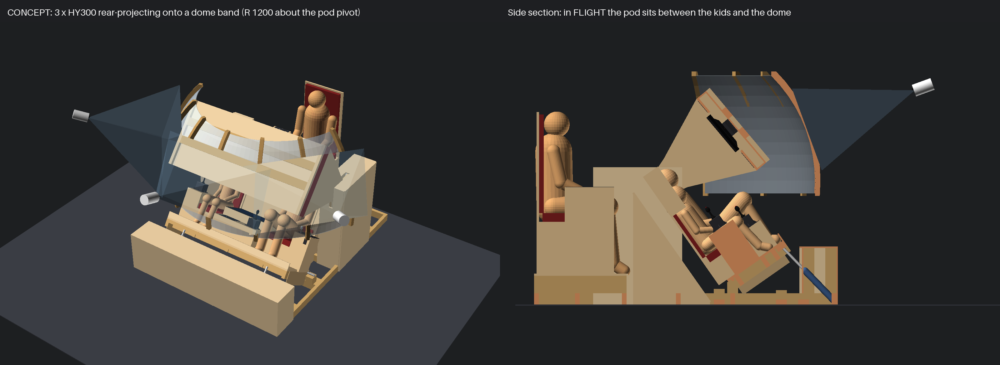

# Feasibility study: HY300 rear-projection dome

Question: instead of (or in addition to) the two 27" monitors, could cheap HY300
mini projectors rear-project onto a dome around the cockpit for a wrap-around view?

Concept render (`cad/assembly/dome_concept.scad`, built by `cad/tools/build.py`):

## Recommendation (short)

**Do not build the dome now; keep the two Sceptre monitors in the pod.** With the
drop-down pod the screens are already 540-590 mm in front of the kids' eyes and the
pod itself hides ~70 % of any dome behind it, a 3-projector HY300 dome would be
~38 nits (vs ~250 for the monitors), parallax-wrong for two kids sitting 920 mm
apart, needs more video outputs than the 6800 XT has left, and makes the room
footprint ~4.6 x 4.5 m. If you want the "space around us" feeling later, the cheap,
low-risk add-on is **one HY300 front-projecting an ambient starfield / planet
onto the ceiling or the wall beyond the cockpit** from the spare USB-C output (one
Godot window, no blending, no warp beyond keystone), or a translucent "side window"
panel at the left casing. A real dome is only worth it as a v2 that *replaces* the
monitors (option D below) with 3+ brighter 1080p projectors.

## The HY300 (Magcubic and clones)

| | |
|---|---|
| Native resolution | 1280 x 720 (accepts 1080p/4K, scales down) |
| Brightness | ~200 ANSI lm (Pro: 170; clones 100-150) -> ~27 cd/m2 on a 1.44 m wide white wall |
| Throw ratio | 0.8 : 1 (some clones 1.37 : 1) - check yours |
| Focus distance | 0.6 - 2.5 m (image 0.75 - 3.1 m wide) |
| Inputs | 1 x HDMI, USB, Wi-Fi casting (high latency - use HDMI only) |
| Other | manual focus, auto vertical keystone (turn it OFF for warping), LCD (black level ~1/1500), 25 dB fan, ~0.8 kg, ~95 x 160 mm |

## Size versus throw

Rear projection puts the projector *outside* the dome, one throw distance away.
For a dome band of radius R around the pod pivot (the reclined head):

| Dome R | Projectors across (+-75 deg) | Image width each (incl. 10 deg overlap) | Throw (0.8:1) | Outer radius of projectors | Room needed (approx.) |
|---|---|---|---|---|---|
| 1.2 m (concept) | 3 | 1.26 m | 1.0 m | 2.3 m | 4.6 W x 4.5 L m, ceiling >= 2.2 m |
| 1.5 m | 3 | 1.57 m | 1.26 m | 2.8 m | 5.6 x 5.0 m |
| 1.2 m | 6 (2 rows) | 1.26 m | 1.0 m | 2.3 m | as above + upper row, ceiling ~2.6 m |

R must be > ~0.75 m so the pod (max radius 712 mm) never touches it; R = 1.2 m is
about the minimum. One row of 16:9 images on a 60 deg wide patch is only ~34 deg tall
-> a single row covers elevation ~ -5 .. +30 deg; full height needs 2 rows (6 projectors).

## Brightness and hotspotting

- Band area (R 1.2, +-75 deg, -5..45 deg) ~3.0 m2. 3 x 200 lm, -15 % blend losses, ~70 %
  rear-screen transmission -> ~120 lux -> **~38 cd/m2** (6 projectors ~76). The
  monitors give ~250 cd/m2. Usable only in a dark room; space scenes are fine, a
  sunlit planet looks dull.
- **Hotspot**: on a rear-projection screen the viewer sees the projector's lens as a
  bright spot when eye, screen point and lens line up; the lower the screen gain the
  smaller the effect. Use a gain ~0.8-1.0 diffuser: stretched white spandex /
  rear-projection fabric on a rib frame, or sanded 1-2 mm PETG/acrylic panels. With
  0.8 throw the light hits the dome edges at ~30 deg, so expect 20-30 % edge
  fall-off (compensate in the blend masks).
- Rear projection avoids the big front-projection dome problem (light scattering
  across the dome washes out contrast) and the kids never shadow the image.

## Edge blending and the Godot warp

- The HY300 has no blending or warp: everything is done on the PC.
- Godot 4: render the scene from the **eye point** into one wide view (cube map or
  3 SubViewports with cameras turned +-60 deg), then each projector window shows a
  full-screen mesh whose UVs come from a calibration (photograph a projected dot
  grid with a phone, solve UV per vertex; or hand-tweak a 9 x 5 grid per projector
  with arrow keys and save it as JSON). A shader multiplies by a blend mask (linear
  ramps in the ~10 deg overlap, raised to 1/2.2 for gamma).
- LCD black level: overlap zones show double black. Space scenes are nearly black,
  so the overlap bands will be visible unless black is lifted everywhere else
  (costs contrast).
- Colour: units are 8000 K +-10 %; match with per-projector RGB gains in the shader.
- Focus: on a curved dome the throw varies by ~16 % across each image; with manual
  fixed focus the edges go soft.
- Latency: 720p panels add a frame or more; acceptable for this game.
- **Parallax**: a dome image is correct for one eye point. The kids' eyes are 920 mm
  apart at R = 1.2 m: for each kid, far objects are displaced up to ~21 deg and the
  horizon bends. A large dome (R >= 3 m) reduces this but does not fit a room. The
  monitors avoid the problem: each kid has his own window rendered for his own eye.

## GPU output count (RX 6800 XT: 2 x DP, HDMI, USB-C, max 4 heads)

Current use: C275B (DP), C275W (HDMI), TD2220 (DP via DVI adapter) -> 1 free (USB-C).

| Option | Outputs | Verdict |
|---|---|---|
| A. 1 ambient projector on USB-C -> HDMI | 4/4 | **recommended add-on**: no blending, one extra Godot window |
| B. 3 projectors via one DP -> 3 x HDMI splitter (Matrox TripleHead2Go-class / "video wall" box, 3840 x 720 or 5760 x 1080 surface) | 4/4 | works, splitter ~150-300 $, Godot renders one wide window and warps it in thirds |
| C. Second GPU or a second PC (mini PC) running the dome as a networked view client | 3 + n | most flexible, most work |
| D. Dome *replaces* the monitors: 3 projectors on DP1, DP2/HDMI, TD2220 on USB-C -> DVI | 4/4 | only as v2 with brighter 1080p units; pod becomes a panel frame with an open window |

## Fit with the cockpit

- The dome band is concentric with the pod pivot, so the pod swing (<= 712 mm) never
  reaches it. But its lower edge (~0.9 m above the floor) runs across the side entry
  gaps in front of the casings (at the seats it is ~1.0 m out from the centre line),
  so the kids would duck under it to board; the dome ends would have to hinge or
  start higher (elevation >= 10 deg).
- **Occlusion**: in flight the pod sits 600 mm in front of the kids. From the
  PILOT's eye it blocks azimuth ~ -32..+65 deg and elevation ~6..70 deg; from OPS the
  mirror image. What is left of a +-75 deg dome are two side strips (~40 deg each)
  and a sliver below the pod (where the legs and the nose box are) -> ~70 % of the
  dome is hidden. That is the main reason not to build it with the drop-pod design.
- Projectors 1 m outside the dome need stands/ceiling mounts out of reach (hot
  lenses, cables across the floor) and add ~1 m to every side of the footprint.
- Cost (3 HY300 + fabric + ribs + splitter) ~400-600 CAD, plus significant
  calibration time.

## Verdict

Keep the monitors. If wanted, add option A (one HY300 ambient projection onto the
ceiling above/forward of the pod, or a wall) - it uses the spare USB-C output, needs
no blending and gives the "you are in space" feeling in the kids' peripheral vision.
Revisit a real dome (option D, 3 x 1080p >= 1000 lm short-throw projectors) only if
the cockpit is rebuilt without the monitor pod.
